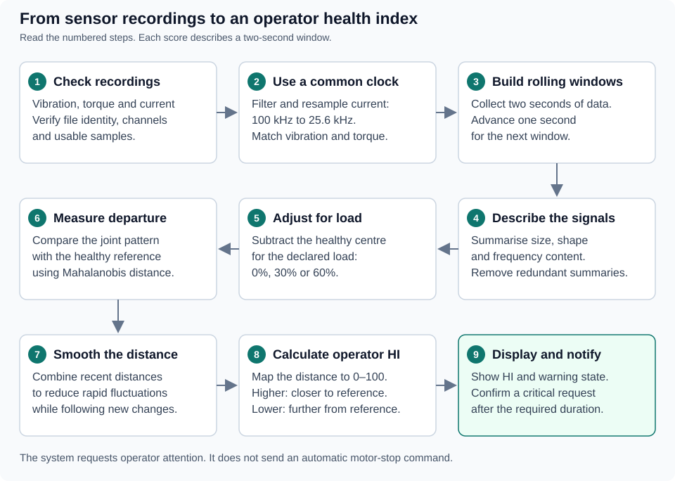
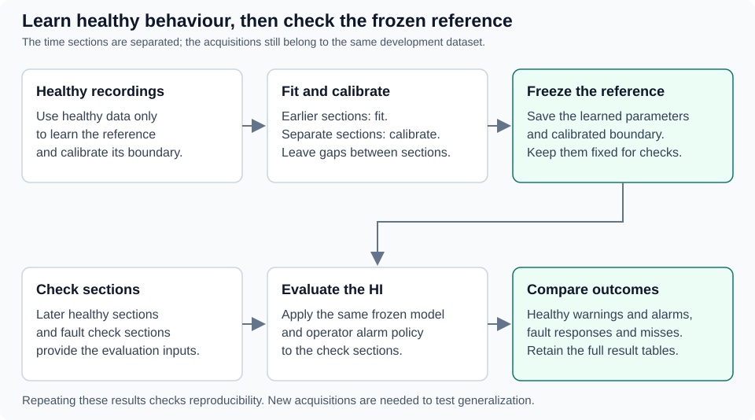

# OPTIBELT — a Python health index for motor monitoring

OPTIBELT brings vibration, torque and three-phase motor current together into one **health index (HI)**. The aim is to help an operator notice when a motor's behaviour moves away from its healthy reference, inspect the signals behind that change, and decide whether the machine needs attention.

The score runs from **100 down to 0**: higher means closer to the healthy reference; lower means a larger departure. It is a monitoring score, **not a measured percentage of remaining motor life**.

This repository contains the reproducible Python implementation, a web dashboard and a prototype streaming pipeline. Earlier MATLAB work informed the development, but **MATLAB is not needed to run this project**. Python reads the `.mat` recordings directly.

**Current scope:** a load-aware research candidate tested on the available dataset subset. It requests operator attention; it does **not** automatically stop a motor. Testing on independently acquired recordings and physical live sensors remains future work.

## What you can do

- Rebuild the HI from the same raw recordings and compare your results with the recorded reference results.
- Play back recordings in the dashboard, follow the HI and inspect warning/critical events.
- Explore raw signals and vibration FFT/envelope spectra in the analysis view.
- Try the simulated-live pipeline, which feeds recorded samples through the streaming engine.
- Run software tests without downloading the large dataset.

## How it works

Instead of judging every sensor separately, the HI asks: **how unusual is this combination of readings compared with healthy motor behaviour?**



1. **Check the inputs.** The pipeline checks file fingerprints, expected channels and sample validity. Missing vibration, invalid samples or flat signals are not silently filled in and treated as healthy.
2. **Align the sampling rates.** The source records current at 100 kHz and vibration/torque at 25.6 kHz. Current is filtered and resampled to 25.6 kHz, so the same time window can be compared across sensors. This removes higher-frequency current content; it does not preserve the full 100 kHz bandwidth. A common clock also does not prove that physical sensor clocks were synchronized.
3. **Describe each window.** The code calculates 12 summaries per channel: signal level, variation, peak behaviour and where frequency energy sits. The model removes unsuitable or redundant summaries; the current load-aware reference retains 36 of the initial 60.
4. **Account for load.** Healthy behaviour differs at 0%, 30% and 60% load. The model subtracts the healthy centre for the declared load before comparing the remaining pattern with a shared reference. Load is supplied as metadata; the model does not infer it automatically. HP identifies supported conditions but does not select a separate fitted model.
5. **Calculate and smooth the distance.** Mahalanobis distance measures how far the combined pattern is from normal, taking relationships between the summaries into account. An exponentially weighted moving average reduces rapid fluctuations while keeping recent measurements influential.
6. **Display the HI and apply alarm rules.** A larger smoothed distance becomes a lower HI. Zone boundaries, recovery margins and elapsed time determine the operator state.

### Learning the reference and checking the result

Healthy recordings provide separate time sections for fitting, calibration and checking, with gaps between sections. Fault recordings are used to examine response, not to fit the healthy reference or choose its calibration threshold.



These are **development checks within the available acquisitions**, not a claim of untouched, independent test data. Reproducing them checks repeatability. New recordings are needed to test generalization.

### Understanding the score and alarms

| New reading | Meaning |
|---|---|
| HI from 60 to 100 | Within the normal display zone |
| HI from 25 up to, but not including, 60 | Warning: inspect the change |
| HI below 25 | Critical zone: begin confirmation timing |

The default critical request needs **3 elapsed seconds continuously below 25**. At one update per second, that takes four consecutive below-boundary readings spanning three seconds. The interface also supports the tested 2- and 5-second choices.

Recovery uses a small margin, called **hysteresis**: warning clears at 65 and critical clears at 30. This avoids repeatedly switching states when the score hovers near a boundary. A confirmed request stays latched until there is a valid recovered reading and an operator acknowledges it. The alarm popup does not pause playback or issue a motor-stop command.

The first distance needs two seconds of samples. Ten initial windows are excluded from alarm decisions: the first eligible score is at about 12 seconds, and the earliest default confirmed request is at about 15 seconds from a new segment's start. These are signal-time timings; acquisition, processing and display delays add to them in a physical installation.

<details>
<summary>The score formula</summary>

For smoothed distance `d` and its calibrated reference boundary `q`:

```text
operator HI = 100 / (1 + (2/3) × (d/q)²)
```

At `d = q`, the displayed HI is 60. The current EWMA smoothing weight is 0.2. Some historical experiment files retain an older score whose boundary maps to 50; dashboard decisions use `operator_hi` and the operator policy described above.

</details>

## Dataset: download separately

The recordings come from Wonho Jung's **AC Motor Testbed under constant or varying speed** collection on Mendeley Data. They are several gigabytes in size and **are not included in this GitHub repository**.

- [Search the collection on Mendeley Data](https://data.mendeley.com/research-data/?search=Vibration%20and%20Motor%20Current%20Dataset&query=AC%20Motor%20Testbed%20under%20constant%20or%20varying%20speed)
- [AC Motor Testbed — AC.zip](https://data.mendeley.com/datasets/b6sww7ytyt/1)
- [AC Motor Testbed — AC.z05, including the archive instructions](https://data.mendeley.com/datasets/gr8c9ckhxh/3)

The publisher describes a **seven-part split archive**. Collect all seven matching parts:

```text
AC.z01  AC.z02  AC.z03  AC.z04  AC.z05  AC.z06  AC.zip
```

Put them in the **same folder**, keep their filenames unchanged, then extract **`AC.zip`** with an archive utility that supports split ZIP archives, following the publisher's instructions. Do not create another ZIP around the parts or extract each part separately. Allow enough disk space for both the downloaded archive and the extracted recordings. Use parts from the same archive release; matching filenames alone do not establish compatibility.

**Availability checked 9 November 2026:** the linked `AC.zip` entry is labelled `_v2` and lists an embargo ending **16 February 2027**. The `AC.z05` version-3 page is visible, but one available part is not enough to reconstruct the archive. Check the publisher's current availability before starting a large download. The original local subset used here has not been shown to be byte-identical to a future download of the full archive.

The dataset description gives the native sampling rates and links its accompanying [Data in Brief article](https://www.sciencedirect.com/science/article/pii/S235234092500678X). Cite the dataset version actually used. The `AC.z05` page lists CC BY 4.0; check the applicable terms on each downloaded release. Dataset licensing is separate from this project's software licensing.

### Which recordings does this project use?

This project does not claim to use every recording in the full collection. [The input manifest](dataset/manifests/recording_hashes.csv) lists the 41 original local files and their SHA-256 fingerprints. Of these, 32 passed the initial completeness checks; seven lack vibration and two shorter recordings were investigated separately. Four complete cases lack the healthy-condition support required by this candidate, leaving **28 supported recordings: 17 healthy and 11 faulty** for the primary comparison.

Use the manifest to locate the required files after extraction. Preserve the actual `.mat` contents and arrange the selected files under:

```text
your-raw-data-folder/
├── invariant_speed/
│   └── recording-name.mat
└── varying_speed/
    └── recording-name.mat
```

This is the layout expected by the project, not a promise about the archive's top-level directory names. The reproduction command verifies file fingerprints. If a newer download differs, investigate the difference; do not bypass the checks and call it an exact reproduction.

## Try it without the large dataset

Install Git and [uv](https://docs.astral.sh/uv/). Python 3.14 is the tested version; `.python-version` and `uv.lock` record the core setup.

```sh
git clone https://github.com/sbuda47/OPTIBELT-Python-HI.git
cd OPTIBELT-Python-HI
uv sync --locked
uv run python -B scripts/verify_release.py
uv run pytest tests -q -p no:cacheprovider
```

The release check verifies the saved model and frozen implementation, then processes synthetic feature vectors. The **108 core tests** use small generated fixtures, so no dataset download is needed. Passing them verifies software behaviour; it is not a new motor experiment.

## Reproduce the HI from raw data

After obtaining the required recordings through an authorized route, run from the repository root:

```sh
uv run python -B scripts/reproduce_current.py --data-root "/path/to/your-raw-data-folder" --output outputs/runs/reproduction_001
```

Replace the data path with your actual folder. Quote Windows paths containing spaces. It is fine to keep the data on another drive. Allow several GB of working memory; one loaded recording matrix alone can occupy about 1.2 GB.

The command checks the input hashes, extracts the features, rebuilds both the pooled comparison reference (**A**) and the chosen load-aware reference (**C**), and recalibrates using healthy data only. It then checks the rebuilt parameters and outcomes against the frozen results. An existing output directory is never overwritten: choose a new output name for another run.

Expected output:

| File or result | What it tells you |
|---|---|
| `run.json` | Completion status, input fingerprints and output fingerprints |
| `refitted_bundle.json` | The model rebuilt during your run |
| `calibration.json` | The recalculated boundaries and calibration evidence |
| `predictions.csv` | 2,210 window/reference predictions |
| `record_metrics.csv` | 56 recording/reference comparisons across the 28 recordings |

A successful run reports that the healthy-only refit, thresholds and **all 56 comparisons** match the frozen candidate within the specified numerical tolerances. Different timestamps are expected; unexplained numerical or input differences need investigation.

See [REPRODUCING](docs/REPRODUCING.md) for the verified-feature-cache route, additional studies and troubleshooting. Use the [reproduction report template](reproducibility/REPORT_TEMPLATE.md) to return your commit ID, environment, commands and findings.

## Open the dashboard or try streaming

The web dashboard combines playback, the HI gauge, operator notifications and signal/FFT/envelope analysis. Its Python backend uses the same HI and alarm logic as the research pipeline. Spectral patterns support investigation; they do not automatically establish a fault diagnosis.

Follow [APPLICATIONS](docs/APPLICATIONS.md) to install the separate application dependencies, build the frontend and start the local services:

| Application | Setup and data needed | Local address |
|---|---|---|
| Playback and analysis | Application Python environment, Node/npm, frontend build and a successful reproduction run | `http://127.0.0.1:8765` |
| Simulated-live monitor | Application Python environment; a selected raw recording for simulation | `http://127.0.0.1:8766` |

For native-signal analysis and simulation, the files must also be accessible at their manifest paths under the ignored `dataset/raw/` directory. The raw reproduction command alone can use an external data directory. Playback reads `outputs/runs/reproduction_001` by default; `OPTIBELT_REPLAY_RUN` selects another run.

The streaming prototype accepts small sample packets, builds rolling windows and updates the HI as samples arrive. It has been tested using recorded data. Connecting physical sensors still requires an acquisition adapter, sensor calibration, synchronized timing and installation-specific validation. No motor-control endpoint is provided.

## What has been demonstrated so far?

For the chosen load-aware C reference on the supported development check sections:

| Outcome | Result |
|---|---|
| Healthy recordings with confirmed critical requests | 0 of 17 |
| Healthy recordings with warnings | 2 of 17 |
| Faulty recordings with confirmed critical requests | 10 of 11 |
| Faulty recordings with a non-normal indication | 11 of 11 |

The missed critical request is retained in the results. Full-record replay produced warnings in four healthy recordings, so the check-section count must not be presented as a full-run false-alarm rate. There is no HP-specific fitted model, and unsupported operating conditions are not covered by these claims.

Local preparation verified raw-data and feature-cache reproduction, **140 Python tests** including application integration checks, and the dashboard production build. The [preparation record](docs/PREPARATION_RESULTS.md) explains the test environments and limits. [CURRENT_STATUS](docs/CURRENT_STATUS.md) summarizes feature/sensor comparisons, window-size experiments and streaming evidence.

## Repository map

| Folder | Purpose |
|---|---|
| `src/optibelt_hi/` | Frozen scientific implementation |
| `outputs/releases/hi_candidate_v1/` | Saved model and implementation fingerprints |
| `configs/` | Signal processing settings |
| `dataset/manifests/`, `dataset/splits/` | Input identities, admission decisions and historical split records |
| `scripts/`, `tests/` | Reproduction commands, integrity checks and core tests |
| `web_dashboard/`, `dashboard/data.py` | Web interface and shared Python adapter |
| `live_pipeline/` | Streaming engine, recording simulator and local API |
| `experiments/` | Additional study scripts, with their own prerequisites |
| `reproducibility/` | Expected results and collaborator report template |
| `docs/` | Setup, methodology, limitations and historical research notes |

Raw files, split archives, generated runs, environments and logs are excluded by `.gitignore`. Keep `.gitattributes` intact: it preserves the frozen files' exact bytes for the integrity checks. Some historical audits need the separate original provenance archive; the reproduction guide identifies these dependencies.

## Citation and acknowledgement

Current software version: **0.1.0**

If you use OPTIBELT-Python-HI to generate, analyse or report research
results, please cite the software version and Git commit used.
If you modify the implementation, identify those changes and
acknowledge the original project.

Repository: https://github.com/sbuda47/OPTIBELT-Python-HI

Fixed release: [v0.1.0](https://github.com/sbuda47/OPTIBELT-Python-HI/releases/tag/v0.1.0)

## Attribution and licensing

The motor recordings are credited to **Wonho Jung and the dataset contributors** through the Mendeley records and associated article linked above. This repository distributes the research implementation and derived reference artifacts, not the raw dataset.

No software license has been selected for this initial repository. Public access does not itself grant an open-source license; dataset licence terms do not license this code. Formal project author/citation metadata can be added when supplied by the project owner.
